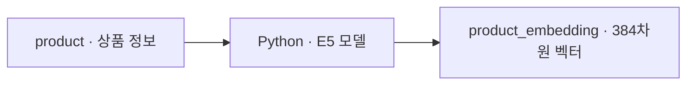
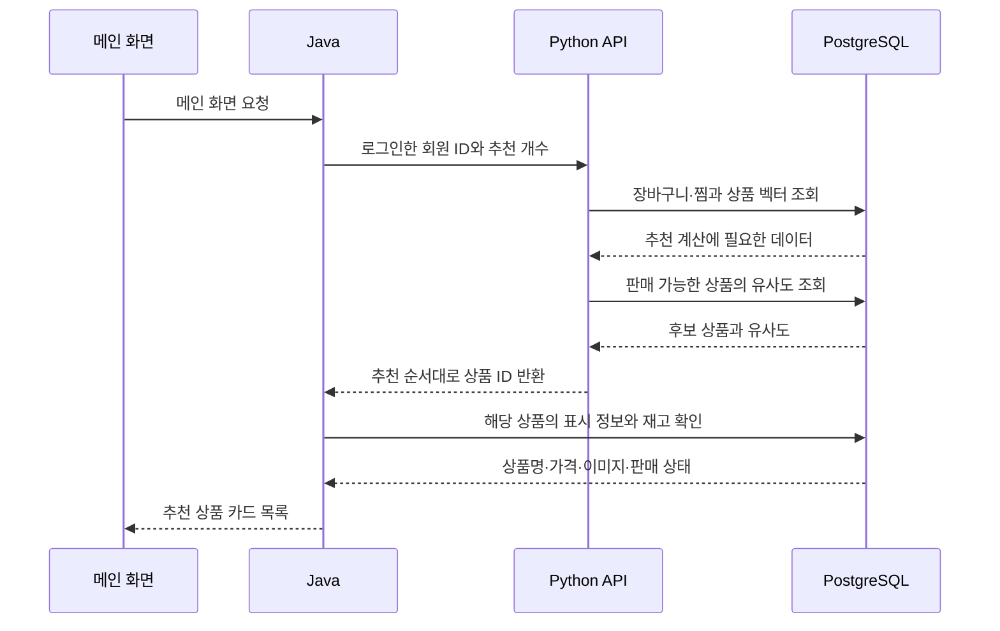

# ssok AI

개인화 상품 추천 기능을 개발하기 위한 초기 저장소입니다.

## DB 구축

Windows 노트북에 PostgreSQL 16 + pgvector를 띄우고 **목업 상품 22개와 상품별 384차원 E5 벡터 22개**를 저장하는 절차입니다. Docker Desktop을 실행하고 Git, JDK 21, Python 3.11 이상을 준비하세요. 아래 명령은 **PowerShell** 기준입니다.

### 1. 두 저장소와 로컬 설정 준비

원하는 작업 폴더에서 두 저장소를 나란히 받습니다. 이미 받은 저장소는 해당 브랜치에서 `git pull --ff-only`로 최신화하세요.

```powershell
git clone -b develop https://github.com/ssafypentakill/ssok.git ssok
git clone -b main https://github.com/ssafypentakill/ssok-AI.git ssok-AI
cd ssok
if (!(Test-Path .env)) { Copy-Item .env.example .env }
notepad .env
```

`ssok/.env`에서 `POSTGRES_DB`, `POSTGRES_USER`를 확인하고 `POSTGRES_PASSWORD`에 노트북용 비밀번호를 입력합니다. `EMAIL_VERIFICATION_HMAC_SECRET`에는 **32바이트 이상의 Base64 키**가 필요합니다. 다음 명령으로 로컬 키를 한 번 생성해 출력값을 붙여넣고 저장하세요. 아래의 DB 실행 명령도 같은 `ssok` 폴더에서 실행합니다.

```powershell
$bytes = New-Object byte[] 32
$rng = [System.Security.Cryptography.RandomNumberGenerator]::Create()
$rng.GetBytes($bytes)
$rng.Dispose()
[Convert]::ToBase64String($bytes)
```

### 2. DB 실행 및 Java 테이블 생성

팀 Compose 설정을 사용하면서 DB 이미지만 pgvector 버전으로 지정합니다. 아래 명령은 두 저장소 **바깥**에 로컬 설정 파일 하나를 만듭니다.

```powershell
@'
services:
  psql:
    image: pgvector/pgvector:pg16
'@ | Set-Content -Encoding ascii ../compose.pgvector.yaml
docker compose -f compose.yaml -f ../compose.pgvector.yaml up -d psql
docker compose -f compose.yaml -f ../compose.pgvector.yaml ps
```

`psql` 상태가 `healthy`이면 Java를 실행합니다. `java -version`이 21인지 확인하고, 다른 버전이면 현재 PowerShell의 `JAVA_HOME`과 `Path`를 설치한 JDK 21에 맞추세요.

```powershell
java -version
.\gradlew.bat bootRun
```

`Started SsokApplication`이 나오면 Hibernate가 쇼핑몰 테이블을 준비한 상태입니다. DB 작업만 할 때는 `Ctrl+C`로 Java를 종료해도 됩니다. PostgreSQL 컨테이너는 실행해 두세요.

### 3. 임베딩 테이블 생성

PowerShell에서 아래 명령으로 DB에 접속합니다.

```powershell
docker exec -it psql sh -c 'psql -U "$POSTGRES_USER" -d "$POSTGRES_DB"'
```

이제 **psql 창**에서 아래 SQL을 실행합니다. `product_id`는 Java가 생성한 실제 상품 키를 참조합니다.

```sql
CREATE EXTENSION IF NOT EXISTS vector;
CREATE TABLE IF NOT EXISTS public.product_embedding (
    product_id bigint PRIMARY KEY REFERENCES public.product(product_id) ON DELETE CASCADE,
    embedding vector(384) NOT NULL,
    model_name text NOT NULL,
    updated_at timestamptz NOT NULL DEFAULT now()
);
```

`\q`를 입력해 PowerShell로 돌아옵니다.

### 4. 목업 데이터와 벡터 저장

```powershell
cd ../ssok-AI
python -m venv .venv
.\.venv\Scripts\python.exe -m pip install -r requirements.txt
.\.venv\Scripts\python.exe scripts/seed_postgres.py
.\.venv\Scripts\python.exe -m app.recommendation.store_mock_embeddings
```

시드는 회원 9명과 상품 22개, 장바구니·찜·주문·결제 예시를 넣습니다. 실제 회원 ID는 각 DB에서 발급하므로 시드가 출력한 `member_id`를 사용하세요. 마지막 명령은 최초 실행 시 E5 모델을 다운로드하며, **22/22개 상품의 384차원 벡터가 일치한다**는 메시지가 나오면 완료입니다. 두 데이터 저장 명령은 다시 실행해도 중복 행을 만들지 않습니다.

DB에서 직접 확인하려면 3단계의 명령으로 접속해 아래 SQL을 실행하세요. 목업 상품명이 22줄 나오고 각 `dimensions` 값이 `384`이면 됩니다. 품절·판매 종료 상품도 관심 이력에 활용하도록 벡터를 보관합니다.

```sql
SELECT p.product_name, p.status, p.stock_quantity, vector_dims(e.embedding) AS dimensions
FROM public.product AS p
JOIN public.product_embedding AS e USING (product_id)
WHERE p.image_url LIKE '/mock/ssok-reco-v1/%'
ORDER BY p.product_id;
```

다음 날에는 Docker Desktop을 켜고 `docker start psql`로 기존 DB를 사용하세요. 데이터는 `psql_data` 볼륨에 유지됩니다. `docker compose down -v`는 이 볼륨도 삭제합니다. 아래의 CSV 추천 미리보기는 별도 실행 경로이며, DB 구축 완료 여부는 위 SQL로 확인할 수 있습니다.

## 추천용 목업 데이터

### PostgreSQL에 들어가는 데이터

[로컬 DB 시드](scripts/seed_postgres.py)는 상품·회원·장바구니·찜·주문·결제를 관계형 테이블에 저장합니다. 아래는 시드를 처음 실행했을 때 추가되는 데이터입니다.

| 테이블 | 건수 | 한 행의 의미와 예시 |
|---|---:|---|
| `product` | 22 | 상품 한 종류. 경량 러닝화는 스포츠 카테고리, 가격 79,000원, 재고 12개, 상태 `ACTIVE`입니다. |
| `"user"` | 9 | 테스트 회원 한 명. 모두 `provider = 'MOCK'`, `status = 'ACTIVE'`이며 이메일은 `ssok-seed-sport@example.invalid` 형식입니다. |
| `cart` / `cart_item` | 7 / 13 | 장바구니에는 소유 회원 ID가, 장바구니 항목에는 장바구니 ID·상품 ID·수량이 들어갑니다. 러닝 양말 2개는 수량이 2인 한 행입니다. |
| `wishlist` | 14 | 회원 ID와 찜한 상품 ID 한 쌍입니다. |
| `orders` / `payments` | 2 / 2 | 스포츠 회원의 79,000원 결제 완료(`PAID` / `APPROVED`)와 디지털 회원의 49,000원 취소(양쪽 모두 `CANCELED`)입니다. 두 테이블은 `order_id`로 연결됩니다. |

회원별 장바구니와 찜은 다음과 같습니다. 추천 함수에 넘길 숫자 ID는 시드 실행 결과의 `member_id`에서 확인하세요.

| 회원 시나리오 | 장바구니 | 찜 |
|---|---|---|
| `sport` · 스포츠 | 경량 러닝화, 러닝 양말 2개 | 트레일 러닝화, 품절 러닝화 |
| `desk` · 디지털 | 저소음 키보드, 무선 마우스 | 노트북 받침대, 판매 종료 키보드 |
| `mixed` · 혼합 | 러닝 티셔츠 | 데스크 패드 |
| `new` · 신규 | 없음 | 없음 |
| `coffee` · 홈카페 | 수동 커피 그라인더, 에티오피아 원두 2개 | 도자기 드리퍼, 드립 주전자 |
| `cook` · 요리 | 무쇠 프라이팬, 원목 도마 | 채소 식도, 양수 냄비 |
| `camp` · 캠핑 | 경량 캠핑 텐트, 충전식 캠핑 랜턴 | 삼계절 침낭, 접이식 캠핑 매트 |
| `weekend` · 캠핑과 커피 | 에티오피아 원두, 충전식 캠핑 랜턴 | 도자기 드리퍼, 삼계절 침낭 |
| `one_like` · 찜만 한 회원 | 없음 | 에티오피아 원두 |

원두는 세 회원이 담거나 찜한 상품입니다. 같은 상품을 둘러싼 관심이 전체 인기 순위에 어떻게 반영되는지 `new`와 `coffee`의 추천을 비교해 볼 수 있습니다.

DB 추천 함수는 현재 장바구니와 찜으로 선호를 계산합니다. 주문·결제 예시는 상품 ID로 이어지는 주문상품 테이블이 없어 구매 점수에 반영할 수 없습니다. 목업 상품 22개 중 품절 러닝화는 재고가 0이고 판매 종료 키보드는 상태가 `DELETED`여서 최종 추천 후보는 20개입니다.

### 추가한 테이블 · `public.product_embedding`

상품당 한 행에 E5 벡터를 저장합니다. [임베딩 저장 명령](app/recommendation/store_mock_embeddings.py)을 실행하면 상품명·카테고리·브랜드·설명으로 만든 벡터 22개가 들어갑니다.

| 컬럼 | PostgreSQL 타입 | 저장 내용 |
|---|---|---|
| `product_id` | `bigint` | 기본 키이자 `product.product_id`를 참조하는 외래 키. 상품 행이 물리적으로 삭제되면 벡터 행도 함께 삭제됩니다. |
| `embedding` | `vector(384)` | 상품 설명에서 계산한 숫자 384개. 회원이 담거나 찜한 상품의 벡터를 읽어 선호 벡터를 만들고 후보 상품과 비교합니다. |
| `model_name` | `text` | 벡터를 생성한 모델 이름. 현재 값은 `intfloat/multilingual-e5-small`입니다. |
| `updated_at` | `timestamptz` | 벡터를 처음 저장하거나 모델 또는 벡터 값이 달라져 갱신한 시각입니다. |

예를 들어 `sport` 회원이 찜한 품절 러닝화의 벡터는 관심사를 계산할 때 사용합니다. 품절 처리는 상품 행과 벡터를 보존하므로, 추천을 반환할 때 `product`의 현재 재고와 판매 상태를 확인합니다.

### 오프라인 추천용 CSV

`data/mock/`에 상품 300개, 회원 50명, 행동 8,441건과 연결된 주문·결제·장바구니 CSV가 있습니다. [데이터 설명과 ERD 매핑](data/mock/README.md)을 먼저 확인하세요.

Python 3.11 이상에서 외부 패키지 없이 재생성·검증할 수 있습니다.

```powershell
python scripts/generate_mock_data.py
python scripts/validate_mock_data.py
python -m unittest discover -s tests -v
```

추천 입력은 `products.csv`, `users.csv`, `splits/train.csv`를 사용합니다. `fixtures/user_preferences.csv`는 생성 규칙 확인용이며 학습 입력에서 제외합니다. `erd/`는 ERD 기반 CSV로, 확정 DDL에 직접 적재하는 SQL seed는 아닙니다.

## 추천 실행 및 테스트

기본 추천 모델은 Hugging Face의 `intfloat/multilingual-e5-small`입니다.
프로젝트 가상환경에서 의존성을 설치하고 실행합니다.

```powershell
cd C:\Users\PC\Desktop\SOOKAI\ssok-AI
# .venv가 없다면 생성
python -m venv .venv
.\.venv\Scripts\python.exe -m pip install -r requirements.txt
```

모델을 웹사이트에서 수동으로 받을 필요는 없습니다. 첫 E5 실행 시 인터넷에 연결해
자동 다운로드합니다. 모델은 `.cache/recommendation/models/`, 상품 벡터는
`.cache/recommendation/vectors-*.json`에 저장되며 Git에서 제외됩니다.
같은 상품 ID·설명은 벡터 캐시를 재사용하므로 이후에는 모델을 로드하지 않습니다.
상품 설명이 바뀌면 내려받은 모델로 벡터를 다시 계산합니다.
모델은 CPU에서 실행하며, 외부 임베딩 API를 호출하거나 상품 설명을 업로드하지 않습니다.
첫 다운로드에는 시간과 디스크 공간이 필요합니다.

```powershell
# 비로그인: 인기 추천
.\.venv\Scripts\python.exe -m app.recommendation.recommender

# 행동이 없는 회원: 인기 추천
.\.venv\Scripts\python.exe -m app.recommendation.recommender --user-id 46 --limit 5

# 행동이 있는 회원: E5 AI 임베딩 개인화 + 인기 추천
.\.venv\Scripts\python.exe -m app.recommendation.recommender --user-id 1 --limit 5

# 기존 TF-IDF와 비교 (모델 다운로드 불필요)
.\.venv\Scripts\python.exe -m app.recommendation.recommender --backend tfidf --user-id 1 --limit 5

# 추천 기능 테스트만 실행
python -m unittest discover -s tests -p test_recommender.py -v

# 전체 테스트
python -m unittest discover -s tests -v
```

`Mode: popular`은 인기 추천, `Mode: personalized`는 개인화가 반영된 추천입니다.
`personalization`은 최종 점수에서 개인화 점수가 차지하는 비중입니다.

`app/recommendation/data_loader.py`가 기본적으로 train 데이터만 읽고,
`app/recommendation/embeddings.py`가 학습된 E5 모델로 상품 벡터를 생성합니다.
상품 간 유사도 비교이므로 공식 모델 안내에 따라 모든 설명 앞에 `query: `를 붙입니다.
`app/recommendation/recommender.py`가 상품 벡터와 행동 가중치
(조회 1 / 좋아요 3 / 장바구니 5 / 구매 10)로 추천합니다.
사용자·상품·행동 종류별 반복 횟수는 최대 3회까지 반영하며, 수량은 가중하지 않습니다.
개인화 비중은 누적 행동 점수 / 10으로 계산하고 최대 80%로 제한합니다.
나머지는 후보 내 최대 인기 점수로 정규화한 인기 점수입니다.
이 비중과 가중치는 초기 규칙이며 validation으로 최적화한 값은 아닙니다.

현재 판매 중이고 재고가 있는 상품만 반환합니다. 이미 조회·구매한 상품은 제외하지 않습니다.
미등록 회원 ID는 인기 추천으로 처리하고, 비활성 회원은 오류로 거절합니다.
상품별 점수는 순위 계산용이며 구매 확률이 아닙니다.

이 실행은 현재 상품 스냅샷을 대상으로 한 추천 미리보기입니다.
과거 시점 Recall/NDCG 평가나 실시간 행동 수집, Java API 연결은 포함하지 않습니다.
현재 판매 상태를 그대로 사용해 과거 추천 성능을 평가하면 안 됩니다.

일반 테스트는 네트워크나 모델 다운로드 없이 TF-IDF 및 가짜 인코더로 로직을 검증합니다.
실제 E5 모델 통합 테스트는 다음과 같이 별도 실행합니다.

```powershell
$env:RUN_E5_INTEGRATION = "1"
.\.venv\Scripts\python.exe -m unittest discover -s tests -p test_embeddings.py -v
Remove-Item Env:RUN_E5_INTEGRATION
```

E5 벡터의 유사도 분포는 TF-IDF와 다르므로 기존 인기/개인화 혼합 비율은 초기값입니다.
모델 교체 후 실제 추천 품질과 비율은 validation으로 비교해야 합니다.
모델 설명과 MIT 라이선스: https://huggingface.co/intfloat/multilingual-e5-small

## Java · Python · PostgreSQL 연동

Java와 Python은 같은 PostgreSQL을 사용합니다. Java는 상품·재고와 회원의 장바구니·찜을 관리하고, Python은 이 데이터를 읽어 추천 순위를 계산합니다. 두 서버 사이에서는 HTTP로 회원 ID를 전달하고 추천 상품 ID 목록을 돌려받습니다.

### 상품 벡터 준비 (현재 구현)

[DB 구축](#db-구축)에서 실행한 Python 스크립트는 목업 상품의 이름·카테고리·브랜드·설명을 E5 모델로 변환합니다. 결과는 같은 DB의 `product_embedding`에 저장하며, `product_id`로 원본 상품과 연결합니다.



### DB로 회원 추천 실행

`ssok-AI` 폴더에서 아래 명령으로 PostgreSQL 추천 함수를 실행합니다. Python에서는
`from app.recommendation.service import recommend_for_member`로 가져와
`recommend_for_member(member_id=4, limit=5)`처럼 호출합니다. 회원 ID는 시드 출력값을 사용하세요.

```powershell
.\.venv\Scripts\python.exe -m pip install -r requirements.txt
.\.venv\Scripts\python.exe -m app.recommendation.service --member-id 4 --limit 5
```

기본 연결은 `localhost:5432`와 옆 저장소의 `../ssok/.env`를 사용합니다. 다른 DB는
`DATABASE_URL` 환경변수로 지정할 수 있습니다. 응답의 `items`는 추천 순서대로 정렬되며
각 항목에 상품 ID, 이름, 유사도, 인기 점수, 최종 점수가 들어갑니다.

### 메인 화면의 추천 요청 (HTTP 연결 예정)

DB 추천 함수는 Python에서 실행할 수 있습니다. 아래는 Java와 FastAPI까지 연결한 뒤의 요청 흐름입니다.



| Python이 확인할 정보 | DB에서 찾는 방법 |
|---|---|
| 회원이 담은 상품 | `cart.user_id`로 장바구니를 찾고, `cart.id = cart_item.cart_id`로 연결해 상품 ID를 읽습니다. |
| 회원이 찜한 상품 | `wishlist.user_id`로 해당 회원의 `product_id`를 읽습니다. |
| 상품 벡터 | 담거나 찜한 상품 ID로 `product_embedding.product_id`를 조회합니다. |
| 추천 가능한 상품 | 목업 기준으로 `product.status = 'ACTIVE'`이고 `stock_quantity > 0`인 상품을 후보로 삼습니다. |

Python은 장바구니 상품에 가중치 5, 찜한 상품에 가중치 3을 적용해 회원의 선호 벡터를 계산합니다. 후보 상품과의 유사도에 전체 회원의 장바구니·찜으로 계산한 인기 점수를 섞어 순위를 정합니다. 장바구니와 찜이 모두 비어 있는 회원에게는 인기 순위를 사용합니다.
